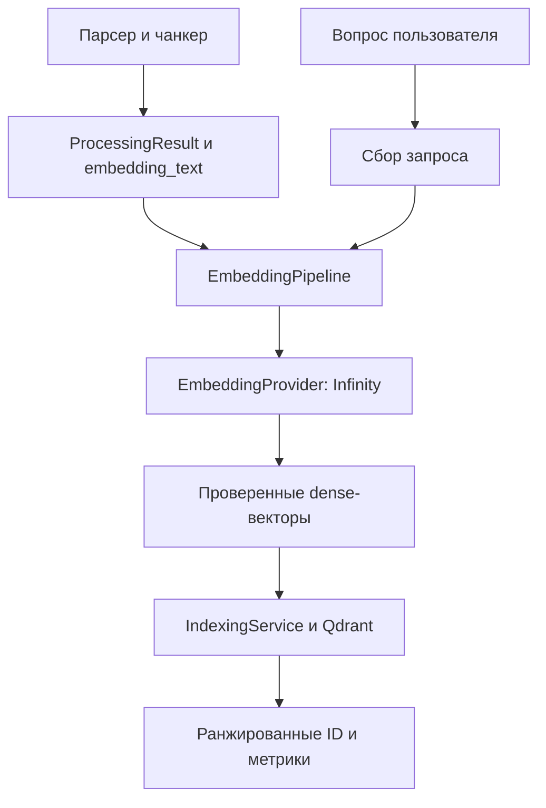

# Архитектура и границы интеграции

Основание: предоставленная «Презентация 29.10.pdf», страницы 6, 16, 19-21;
код upstream commit `c2447d4ff89cb0f5e33006d505e6d0243930c292`.

Страницы 19-21 разделяют ingestion и search. Поэтому буквальная линейная цепочка
«документ -> сбор поискового вопроса -> embedding» была бы ошибочной интерпретацией задания.
Общий класс обслуживает два пути, использующих одну модель.

## Соответствие контрактов

| Граница | Фактический контракт | Решение |
|---|---|---|
| Предыдущий блок | `ProcessingResult`, `Chunk` из `bear_text_beta.models` | Используются напрямую, без второй несовместимой схемы |
| Текст документа | `chunk.embedding_text` | Используется verbatim; `chunk.text` остаётся исходным |
| Контекст | `section_path`, `source_spans`, `attachment_ids`, metadata | Не удаляется и не пересобирается |
| Inference | `embed_batch(texts, purpose)` | Реализован в классе; HTTP остаётся внутри InfinityEmbeddingProvider |
| Презентация | `embed(text)`, `embed_batch(texts)` | Есть оба метода; purpose по умолчанию document |
| Выход ingestion | `EmbeddedChunk(chunk, vector, embedding_profile_id)` | Можно передать существующему `VectorStore.upsert(chunks, result)` |
| Поиск | `IndexingService.search(query, tenant_id, space_id, top_k)` | Использует тот же pipeline через dependency injection |
| Qdrant | Cosine, dimension, tenant/space/generation/profile filters | Контракт сохранён; класс не активирует поколения самостоятельно |
| Метрики | ранжированные ID, qrels, измеренное время | Отдельные функции, не зависящие от БД или эмбеддера |

`vectorize_chunks()` подготавливает DTO; для настоящей индексации использовать
`IndexingService.index(result)`, сохраняющий ChunkValidator, manifest, retry, проверку записи
и переключение активного поколения. Простое `store.upsert()` этих гарантий не даёт.

Формат FusionPipeline содержит `accepted_for_indexing=false` и `source_fidelity=unverified`.
`vectorize_envelope()` отклоняет такой результат. Передача возможна только после внешней проверки
качества источников и явного статуса `accepted_for_indexing=true`, `source_fidelity=verified`.
Код не меняет эти поля и не считает существующий эксперимент production-ready.

## Профиль и длина

`EmbeddingProfile.identifier()` уже включает модель, ревизии, размерность, токенный предел и
раздельные префиксы. Этот ID связывает checkpoint, кэш, Qdrant payload и поисковый фильтр.
Все входы проверяются **с префиксом и специальными токенами**, используя HFTokenCounter.
Длинный текст возвращает ошибку: исправление чанкинга/запроса должно быть видимым действием.

BGE-M3 получает одинаковое пространство без инструкций. E5 получает асимметричные префиксы.
Смысл требования - совместимость одного профиля, а не побайтово одинаковая подготовка обеих сторон.
Смена политики документов, модели, префиксов или tokenizer revision требует новых checkpoint
и переиндексации. Эксперименты со сборкой запросов могут использовать прежний корпус при том же
документном профиле, но должны фиксировать builder_version в отчёте.

## Ответственность за доступ

Проверка разрешений пользователя остаётся в AuthorizationService перед вызовом SearchService,
как на странице 21. Tenant/space-фильтры адаптера не заменяют авторизацию.
SQLiteManifest и local object storage здесь унаследованы от beta-стенда, а не выданы за готовую
реализацию PostgreSQL/Redis Streams/S3. Их production-адаптеры остаются границами основной команды.
Реализован dense-путь; sparse/hybrid и реранкер - отдельные следующие блоки.
